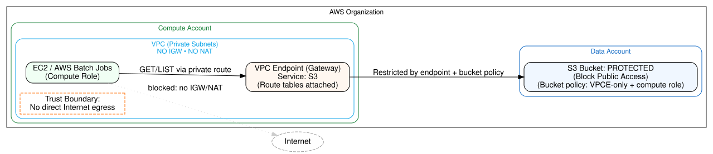

Minimal solution architecture (no Internet egress)



### Key idea
Run Batch/EC2 in private subnets with no IGW and no NAT, and give them a Gateway VPC Endpoint for S3. Lock the S3 bucket to accept reads only via that VPC endpoint and only from your compute role(s). With no IGW/NAT, the compute has no Internet path, so uploads to Dropbox/Drive/SCP out are impossible.

### Components

* VPC (private subnets only): no Internet Gateway; no NAT Gateway.

* S3 Gateway VPC Endpoint: attached to private route tables.

* S3 bucket PROTECTED: Block Public Access; bucket policy enforces:
  - requests come via your S3 VPC Endpoint; and
  - principal must be your compute job role.

* Compute (EC2/Batch): instances/tasks assume ComputeDataAccessRole.

* (Optional) Interface endpoints you might still want (don’t affect exfil posture):

  - CloudWatch Logs/Monitoring (to capture logs without Internet),

  - ECR (if you pull container images), STS/SSM if you need them — all via Interface VPC Endpoints.

### Example configuratio

#### 1) VPC Endpoint: S3 (Gateway)

CloudFormation:
```yaml
Resources:
  S3GatewayEndpoint:
    Type: AWS::EC2::VPCEndpoint
    Properties:
      ServiceName: !Sub "com.amazonaws.${AWS::Region}.s3"
      VpcId: vpc-xxxxxxxx
      VpcEndpointType: Gateway
      RouteTableIds:
        - rtb-private-a
        - rtb-private-b
```
#### 2) S3 bucket policy (deny outside-VPCE and non-compute principals)
```json
{
  "Version": "2012-10-17",
  "Statement": [
    { "Sid": "BlockPublicAccessDefenseInDepth", "Effect": "Deny",
      "Principal": "*", "Action": "s3:*",
      "Resource": ["arn:aws:s3:::PROTECTED","arn:aws:s3:::PROTECTED/*"],
      "Condition": { "Bool": { "aws:SecureTransport": "false" } } },

    { "Sid": "DenyIfNotFromS3VPCE", "Effect": "Deny",
      "Principal": "*",
      "Action": ["s3:GetObject","s3:ListBucket"],
      "Resource": ["arn:aws:s3:::PROTECTED","arn:aws:s3:::PROTECTED/*"],
      "Condition": { "StringNotEquals": { "aws:SourceVpce": "vpce-xxxxxxxx" } } },

    { "Sid": "DenyIfNotComputeRole", "Effect": "Deny",
      "Principal": "*",
      "Action": ["s3:GetObject","s3:ListBucket"],
      "Resource": ["arn:aws:s3:::PROTECTED","arn:aws:s3:::PROTECTED/*"],
      "Condition": {
        "StringNotLike": {
          "aws:PrincipalArn": [
            "arn:aws:sts::*:assumed-role/ComputeDataAccessRole/*"
          ]
        }
      }
    }
  ]
}
```

This means: a laptop command like aws s3 cp s3://PROTECTED . fails because it 1) isn’t via your VPCE and 2) isn’t the compute role.

#### 3) (Optional but helpful) S3 VPCE policy (narrow bucket/prefix)
```json
{
  "Version": "2012-10-17",
  "Statement": [{
    "Sid": "OnlyProtectedBucketPrefix",
    "Effect": "Allow",
    "Principal": "*",
    "Action": ["s3:GetObject","s3:ListBucket"],
    "Resource": [
      "arn:aws:s3:::PROTECTED",
      "arn:aws:s3:::PROTECTED/datasets/*"
    ]
  }]
}
```
#### 4) Compute role policy (read-only to your bucket/prefix)
```json
{
  "Version": "2012-10-17",
  "Statement": [
    { "Sid": "ListBucket", "Effect": "Allow",
      "Action": "s3:ListBucket",
      "Resource": "arn:aws:s3:::PROTECTED",
      "Condition": { "StringLike": { "s3:prefix": ["datasets/*"] } } },

    { "Sid": "ReadObjects", "Effect": "Allow",
      "Action": ["s3:GetObject"],
      "Resource": "arn:aws:s3:::PROTECTED/datasets/*"
    }
  ]
}
```
#### 5) Security group (deny all egress from compute)

You can set no egress rules on the instance SG (which means egress is denied). If you prefer explicit rules:

```yaml
Resources:
  ComputeSG:
    Type: AWS::EC2::SecurityGroup
    Properties:
      GroupDescription: "No egress; inbound per your scheduler/SSM needs"
      VpcId: vpc-xxxxxxxx
      SecurityGroupEgress: []     # empty list => no outbound allowed
      SecurityGroupIngress:
        - IpProtocol: "-1"
          FromPort: 0
          ToPort: 0
          CidrIp: 10.0.0.0/16      # adjust or use only what you need
```

Even if you forget this, with no IGW/NAT there’s still no Internet path — this SG just tightens things further.

#### 6) AWS Batch compute environment (private subnets, no public IP)
```json
{
  "computeEnvironmentName": "no-egress-ce",
  "type": "MANAGED",
  "computeResources": {
    "type": "EC2",
    "subnets": ["subnet-private-a","subnet-private-b"],
    "securityGroupIds": ["sg-no-egress"],
    "instanceRole": "ecsInstanceRole",
    "ec2Configuration": [{"imageType": "ECS_AL2"}]
  },
  "serviceRole": "AWSBatchServiceRole"
}
```

Ensure those subnets have no route to an IGW/NAT, and your task definition/AMI uses the ComputeDataAccessRole.

Why this meets your requirements

i) Allows compute against S3 from Batch/EC2

>Compute runs in private subnets and uses the S3 Gateway VPC Endpoint; ComputeDataAccessRole grants read-only to the target bucket/prefix. ✅

ii) Prevents any data egress from compute to the Internet

> No IGW, no NAT → no route to Internet.
(Optional) Security Group with no egress blocks stray outbound entirely.
Compute can still reach S3 privately via the Gateway Endpoint. ✅

iii) Prevents any data egress initiated externally (e.g., laptop aws s3 cp s3://protected .)

> The bucket policy requires requests to come via your VPC Endpoint and from the compute role. Laptops are neither, so downloads are denied. ✅
